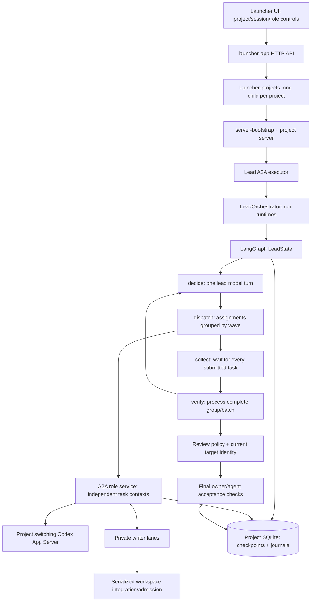

# Current Harness architecture

Evidence: current working-tree source on 2026-10-26, with hashes in
[source-baseline.json](source-baseline.json). Historical design documents explain
intent; they are not evidence of the running server's loaded behavior.

## Execution map

Lane integration occurs inside the specialist service before its terminal result.
The graph's collection barrier still delays processing that result and preparing
new assignments until all submitted siblings settle.

## Terms that currently have different meanings

| Term | Actual source meaning | Consequence for the redesign |
| --- | --- | --- |
| Project | Canonical workspace record, project child, settings and state DB | Keep local scheduling and controls isolated |
| Session | Dashboard A2A context; can retain one lead provider thread across runs | Preserve history; serialize planner use of a shared provider thread |
| Run | One graph/checkpointer trajectory keyed by runId | Keep legacy identity; introduce a stable delivery objective alongside it |
| Round | Counter for a dispatch decision/batch | Audit metadata; not a sprint, day, worker slot or queue |
| Assignment | One role request, ID based on run/round/index | Adapt to a stable backlog task; do not use array position as its identity |
| Attempt | One execution/continuation under an assignment | Preserve deterministic context lookup and distinct retry identity |
| Batch | Up to four assignments emitted by one decision | Planner output bound must not be a pool or backlog capacity bound |
| Wave/group | Consecutive equal non-null wave values; null is a singleton | Replace global wave order with dependency readiness |
| Role | Model, effort, tools, permissions and instructions for a function | Instantiate multiple independent tasks/threads of the same role |
| Lane | Private worktree used by one writable attempt | Reuse isolation; preserve serialized publication to the shared tree |
| Review target | Digest of scoped files and immutable review/run/check context | Extend to durable immutable candidate identity and lineage |

Source anchors: `src/durable-store.js:29`, `src/lead-graph.js:736`,
`src/lead-graph.js:3414`, `src/contracts.js:895`, `src/session-threads.js:9`.
The current orchestrator default is **80 dispatch rounds**
(`src/lead-orchestrator.js:17`), despite historical documents and some comments
that describe an unlimited default. Caller configuration may override it.

## Subsystem navigation and ownership

The complete module/import map is in [knowledge-graph.json](knowledge-graph.json).
The following table gives the useful entry points rather than a directory dump.

| Subsystem | Main source entry points | State and responsibility |
| --- | --- | --- |
| Project process and lifecycle | `src/launcher-projects.js:81`, `server-bootstrap.js`, `src/server.js:850` | Child per project, port, DB, workspace lock, startup reconciliation |
| Lead control | `src/lead-orchestrator.js:214`, `src/lead-graph.js:736` | Runtime signals, graph/checkpoints, decisions, batch, recovery and finalization |
| Schemas and roles | `src/contracts.js:146`, `src/contracts.js:992`, `src/role-catalog.js:179`, `profiles/TEAM.md` | Decision validation, assignment scope, model/effort, tools and instructions |
| Execution | `src/a2a-role-service.js:365`, `src/codex-app-server.js:1018`, `src/app-server-switch.js:6` | Distinct task contexts/threads, provider transport, shared child lifecycle |
| Writer safety | `src/writer-lanes.js:195`, `src/writer-worktree.js`, `src/writer-admission.js:40`, `src/workspace-snapshot.js`, `src/process-quiescence.js` | Isolation choice, staged patches, serialized integration, unknown effects |
| Review | `src/review-policy.js:59`, `src/lead-graph.js:1633`, `src/lead-graph.js:1729` | Scoped current-target receipts, verifier/auditor ordering and write gates |
| Acceptance | `src/acceptance.js:656`, `src/acceptance-scratch.js`, `src/verification-preflight.js:137`, `src/partial-ledger.js` | Pinned checks, permissions, artifact fingerprint, truthful partial disposition |
| Persistence | `src/durable-store.js:93`, `src/session-threads.js:9`, `src/transient-recovery.js:44` | SDK tasks, journal, graph saver, session continuity, delayed safe recovery |
| Budget/accounts | `src/budget-watcher.js:68`, `src/account-profiles.js`, `src/usage-ledger.js:8` | Process-local watcher, global active profile file, per-project usage accounting |
| Evidence and feedback | `src/evidence-store.js:34`, `src/staging-log.js:15`, `src/activity-store.js:10`, `src/loop-guard.js` | Durable evidence/event records, best-effort activity, repeated-work detection |
| UI and reporting | `src/launcher-app.js:283`, `src/launcher-sessions.js:101`, `src/session-situation.js`, `src/session-performance.js`, `src/performance-store.js:118`, `launcher-ui/app.js` | Polling session views, worker activity, isolated performance snapshot DB |
| Knowledge/spec pilot | `src/spec-context.js`, `src/spec-analyzer.js:23`, `src/spec-assignment-adapter.js:239`, `src/aut03-lead-skill.js`, `src/autonomy-evaluation.js` | Validated requirement/task maps and offline autonomy evidence; not the runtime queue |
| Tools and policy | `src/skill-catalog.js`, `src/mcp-catalog.js`, `src/connector-catalog.js`, `src/execution-permissions.js`, `src/project-settings.js` | Pinned tool/skill inputs and owner-selected execution policy |

## Confirmed bottlenecks

| Finding | Source evidence | Interpretation |
| --- | --- | --- |
| F01: all-sibling collection barrier | `src/lead-graph.js:3747`, `:3786` | pollItem waits terminal; Promise.allSettled delays graph planning until all finish |
| F02: one mutable batch, no ready queue | `src/lead-graph.js:736`, `:3414`, `:4480` | New planning is outside execution; early completion cannot refill a slot |
| F03: parallel reviewers depend on writer mode | `src/lead-graph.js:3416`, `:3512` | Automatic read-only parallelism excludes review roles; explicit reviewer groups still depend on parallelWriters |
| F04: broad critical write gate | `src/lead-graph.js:1729`, `:3683` | One incomplete critical checkpoint blocks unrelated writable work |
| F05: response cardinality bound | `src/contracts.js:8`, `:1050` | One decision permits at most four assignments; there is no durable pool behind it |
| F06: moving review/acceptance target | `src/review-policy.js:59`, `src/acceptance.js:780` | Current content identity protects correctness but prevents safe moving-tree review |
| F07: no total/per-role execution pool | `src/a2a-role-service.js:403`, `src/codex-app-server.js:1018` | Duplicate task and same-thread guards exist; role identity is not a pool limit |
| F08: permitted partial exit | `src/lead-graph.js:3167` | False-goal finish with a ledger terminates partial without the ordinary extra investigation path |
| F09: shared App Server failure domain | `src/codex-app-server.js:1486` | Unconfirmed cancellation/child termination can affect concurrent sibling turns |
| F10: UI has attempt history, not backlog | `src/launcher-sessions.js:101`, `src/activity-store.js:95` | No ready/claim/capacity state or explanation for unused worker slots |

These findings do not prove why a particular historical run used one worker.
That attribution needs its decision, effective mode, assignments and timeline.
Two auditors are not categorically forbidden from overlapping: independent
checkpoints with compatible explicit groups can overlap when grouped execution
is enabled. Verifier then auditor for the same critical checkpoint is a real
acceptance dependency and must remain ordered.

## Boundaries worth retaining

- `openStateDatabase` uses WAL and synchronous FULL. Dispatch journal records
  intent before submission. Task lookup uses deterministic attempt context;
  an uncertain writable submission is not blindly repeated.
- Workspace ownership is cross-process and keyed by Git common directory when
  available (`src/durable-store.js:220`). Distinct repositories can run separate
  project servers. Aliases and even worktrees sharing a common Git directory
  intentionally contend. Do not remove that lock to advertise multi-project use.
- Isolated/cooperative lanes can execute writer turns concurrently. The shared
  fallback holds admission for the whole writer turn. Lane patch integration
  holds workspace admission briefly; patches outside scope or with conflicts are
  refused. Cooperative mode does not claim sandbox confinement.
- Review identity includes immutable scope, run, goal, requirement context,
  checks and pins. Unknown identity, stale receipts, unresolved effects and failed
  deterministic checks cannot become accepted through a model verdict.
- Owner pause, emergency stop, explicit cancellation, quota waits and actual
  owner decisions have different meanings. An automatic budget recovery must
  never resume an owner pause or a canceled task.
- A continuing lead session can reuse a provider thread. Distinct run IDs do
  not make concurrent turns on that one thread legal. Planner serialization needs
  its own fence, independently of worker concurrency.

## Existing mechanisms to reuse

Reuse the project SQLite connection, dispatch journal, A2A adapter, role profiles,
writer lane/admission machinery, check pinning, owner controls, evidence refs,
usage ledger and performance collector. Extract policy boundaries from the large
lead graph incrementally; do not rewrite the provider transport and scheduler in
one unreviewable change.

The spec-analysis pilot already validates requirement/task references and can
supply planner context. It is not proof of runtime dependency scheduling. Its
current offline qualification/trial gates remain valid; importing its output
must not silently enable an unqualified optional skill.

## Role settings investigation

Current role overrides support model, effort and extra instructions
(`src/role-overrides.js`); UI options are largely static. Installed App Server
protocol exposes per-model supported reasoning efforts and service-tier fields.
Fast is not currently threaded through Harness role configuration/execution.
The reported effort rendering defect still needs a concrete UI reproduction;
static lists alone do not prove the selected value is rendered incorrectly.
The role-settings package must trace and test saved value, displayed value,
model compatibility, request construction and inherited defaults together.
