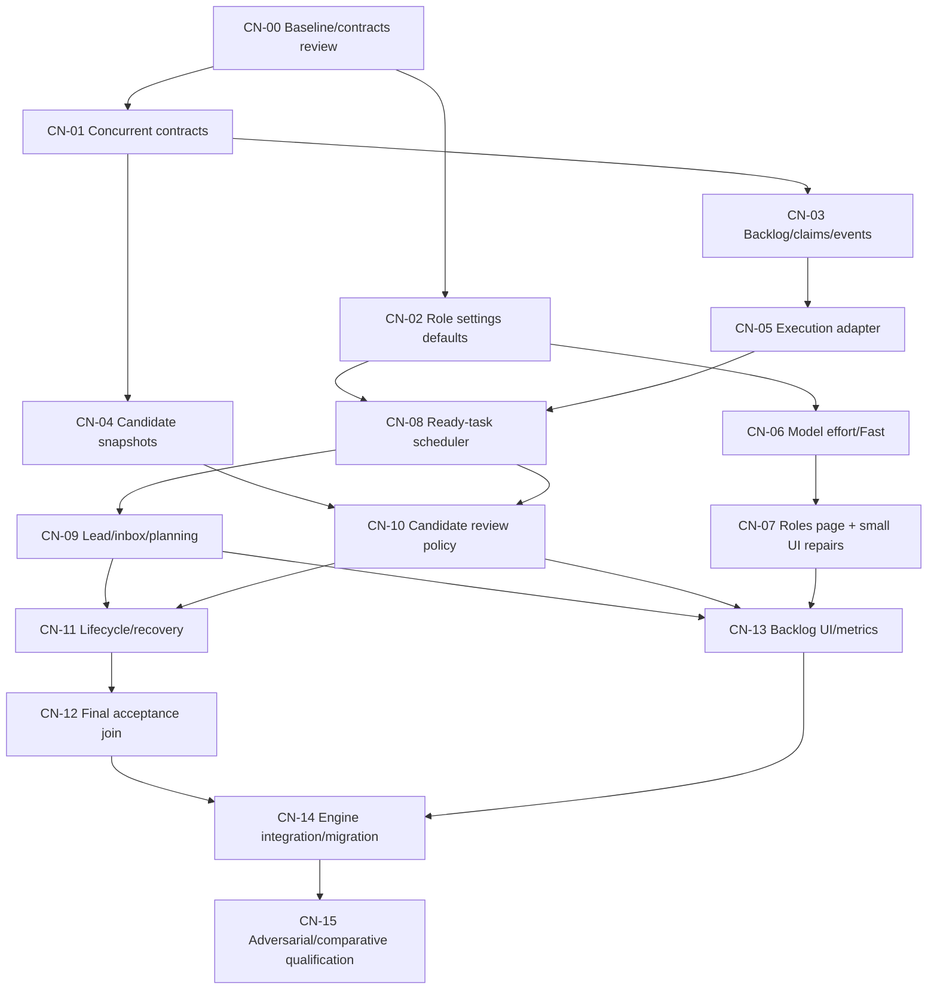

# Implementation packages and succession

> Archived development plan, 2026-11-06. Use the [current autonomous delivery backlog](../../autonomous-delivery-backlog.md) for new work. The historical content below preserves decisions, IDs and evidence; its priorities and restrictions do not override the current owner requirements.

Status: implementation authorized by the owner on 2026-10-26. Role settings and
small UI regressions started first while the concurrent engine design was being
finalized. All other statuses below are planning states, not implementation claims.
See ignored teamwork notes for live ownership and evidence, not durable acceptance.

## Delivery boundaries

M0: architecture, contracts, baseline and independent design review.
M1: configurable team/role UI plus durable task store and execution adapter.
M2: useful parallel workers, per-task completion and an available continuous lead,
with existing broad review barriers retained where necessary.
M3: immutable candidate reviews, scoped critical gates and reliable final join.
M4: integrated lifecycle/migration/UI, adversarial and comparative qualification.

Single-project delivery is the critical path. Existing independent projects remain
compatible. Shared-account arbitration, per-role accounts, Claude integration,
competing implementation tournaments and automatic unlimited agents are excluded.

## Package exit gates versus integrated acceptance

A package is ready for its successors after its **local exit gate** passes and
required independent review accepts it. The V references below are **integrated
scenario coverage**, checked when their participating packages exist, ultimately
at CN-15. They are not additional predecessor gates. Use injected fakes for
successor interfaces at a local gate; never claim those fakes qualify integration.
This distinction prevents acceptance dependencies from creating a hidden cycle.

| Package | Local exit gate achievable before successors |
| --- | --- |
| CN-00 | Source/graph/links and package DAG validate; architecture critic accepts the design without requiring successor code. |
| CN-01 | Pure schema/ID/plan validators reject cycles, stale revisions, mutable active contracts and invalid capability claims; legacy schema fixtures still pass. |
| CN-02 | Override normalization/default projection and old-file roundtrips pass; invalid requests preserve saved fields; scheduler enforcement is not required yet. |
| CN-03 | Two-connection SQLite fixtures prove atomic claims/capacity/event commit, CAS, dedupe, cursors and lease-recovery marking using injected remote-effect facts. |
| CN-04 | Disposable Git fixtures prove immutable snapshots, manifests, parent lineage, reference retention and apply-intent reconciliation without a real review consumer. |
| CN-05 | Fake A2A fixtures prove intent-before-send, deterministic lookup, one terminal settlement, stale-fence rejection and truthful unknown effects with injected candidates. |
| CN-06 | Model metadata normalization, inherited/explicit effort and advertised canonical Fast mapping match fake thread/turn request captures; unknown capability stays explicit. |
| CN-07 | Actual Roles/main browser fixtures plus race/refresh regressions pass; model/effort/capacity/Fast persist and display correctly; no successor scheduler is needed. |
| CN-08 | Fake-executor dependency/resource fixtures fill bounded slots, reserve planner capacity, advance fast-sibling dependents, and schedule independent reviewers without the real planner. |
| CN-09 | Fake scheduler/worker fixtures prove durable steering receipt, versioned lead deltas, short serialized planning turns, coalescing and lookahead while workers remain active. |
| CN-10 | Candidate/receipt fixtures prove immutable review inputs, exact verifier/auditor dependencies, scoped promotion/invalidation and unknown-closure conservative fallback. |
| CN-11 | Controlled process/A2A fixtures prove pause/cancel/budget/restart/reconciliation state transitions and capacity fences using injected final-acceptance outcomes. |
| CN-12 | Frozen candidate fixtures exercise the real acceptance adapter, final barrier, pinned checks, blocked/partial predicates and post-acceptance publication invalidation. |
| CN-13 | API/browser fixtures prove additive paginated projections, stale-project guards, idle reasons and nullable metrics against both old and new schemas. |
| CN-14 | Composition/migration fixtures prove legacy preservation, engine exclusivity, project isolation, startup recovery and drain/reconcile rollback. |
| CN-15 | Integrated scenario matrix is executed with attributable evidence; L6 remains separately unqualified until an authorized real trial succeeds. |

## Package DAG and parallel ownership

At a contract checkpoint, CN-02, CN-03 and CN-04 can have disjoint owners; CN-06/07
form one cohesive UI/settings lane; CN-05/08 form the scheduler/execution lane.
CN-09 and CN-10 can proceed together after their prerequisites. Do not parallelize
edits to server composition, graph contracts or the same UI file without explicit
ownership/integration. Root integration owner controls shared wiring in CN-14.

The initial settings worker owns CN-02/06/07 together, as those changes share
role overrides and UI state. An independent worker owns the token-chart repair in
performance.js. These are sensible cohesive packages, not a demand for a new lead
round between every item. Once acceptance is frozen, the scheduler can dispatch
several ready packages and prepare their successors while they execute.

## CN-00: reusable source map and regression baseline

Dependencies: none. Ownership: planning/evidence docs and disposable probes.
Source: the source baseline, current architecture, target design and role policy.

Deliver a complete knowledge graph and source digest manifest; record the actual
round/wave semantics, same-role reviewers, current locks and prior dirty work.
Keep confirmed source behavior separate from live configuration assumptions.
Reuse valid existing focused verification. Freeze interfaces before implementation
of durable state; independent critic reviews the target's failure windows.

Integrated scenario coverage: HCR references map to packages and V scenarios; all current src modules
are navigable; no broken local evidence link or cyclic package dependency; every
relaxed guard names a replacement invariant. Baseline has five passing focused
wave/lane/reviewer tests, not a claimed new performance benchmark.

## CN-01: versioned concurrent contracts and policy boundary

Dependencies: CN-00. Suggested ownership: new `src/delivery-contracts.js`,
`schemas/delivery-v1.schema.json`, new focused contract tests; role-policy docs.
Keep legacy `DECISION_SCHEMA` and old checkpoint deserialization unchanged.

Implement validated objective/task/dependency/attempt/claim/event/candidate/receipt
records and plan deltas from target-design. Separate source-write intent, writable
scratch, resource claims and publication authority from sandbox mode. Reject cycles,
unknown references, mutable running contracts and stale revision/authority updates.
Define stable IDs independently of round/array index and legacy identity mappings.
Expose pure validation and projection functions, not file-system effects.

Integrated scenario coverage: V01-V05, V13-V14; malformed references and unsupported versions fail
with stable typed reasons; old contracts remain valid. Mandatory risk review:
persistent formats, authority and source/scratch distinction. This is the first
new-engine implementation task after design review.

## CN-02: per-role capacity configuration

Dependencies: CN-00. Initial implementation in progress as part of settings lane.
Ownership: `src/role-overrides.js`, role projections/defaults in launcher-app,
related tests. Coordinate role-catalog changes if profile fields are extended.

Persist `maxConcurrentAgents` and resolve 4/2/2/2 core defaults, one coordinator,
small explicit optional-role defaults. Preserve existing model/effort/rules and
legacy override files. Add finite integer validation and clear effective/default
projection. Counts are execution ceilings, never a start-all instruction.

Integrated scenario coverage: V30; old payloads round-trip; invalid input does not erase prior values;
independent projects retain different settings. Label current UI counts as configured
until CN-08 enforces the pool. Do not insert an arbitrary hidden per-role maximum
in place of a configurable project capacity; reconcile any initial UI cap at CN-08.

## CN-03: transactional backlog, events and fenced claims

Dependencies: CN-01. Ownership: new `src/backlog-store.js`,
`src/delivery-events.js` and focused SQLite tests. Keep table creation in those
modules until CN-14 wires them into project startup; avoid concurrent durable-store
edits. Use existing synchronous FULL connection/transaction semantics.

Implement applyPlan CAS, dependency/readiness projection, paginated queries,
atomic task+capacity claim, attempt intent, fencing tokens, heartbeat/recovery
eligibility, monotonic event sequence, dedupe and durable consumer cursors.
Events and state share a transaction. Network effects never occur in it. Lease
expiry cannot create a duplicate live attempt or release unknown writer effects.
Expose fake-clock injection and deterministic scheduling hooks for crash tests.

Integrated scenario coverage: V01-V05, V24, V27-V29; two connections racing a task create one claim;
restart replays unconsumed events once; row counts/capacity remain correct through
unknown states. Critic and targeted challenger required for persistence/races.

## CN-04: immutable candidate snapshots and publication lineage

Dependencies: CN-01. Ownership: new `src/candidate-store.js`, narrowly scoped
writer-lanes/worktree hooks and new candidate tests. Source: writer-lanes,
workspace-snapshot, review-policy, acceptance and their established guard tests.

Create known immutable candidates from attested workspace manifests, with parents,
base generation, environment/check identity, reference-safe retention and frozen
review copies. Journal integration intent before filesystem changes and reconcile
effect-vs-row crash windows. Reuse admission/mutex; do not claim Git+SQLite atomicity.
Unknown effects, escaping paths, owner edits and conflicts cannot become known
candidates without exact reconciliation. Test output resources are attempt-scoped.

Integrated scenario coverage: V18-V23, V27; no mutation of a referenced snapshot, no duplicate apply,
no silent owner-edit attribution, no deletion of referenced evidence. Strict and
cooperative modes retain truthful claims. Concurrency/data-integrity review and
crash probes are mandatory.

## CN-05: per-attempt execution adapter

Dependencies: CN-03. Ownership: new `src/task-executor.js`, narrowly scoped
A2A role service hooks and tests; coordinate transport edits after settings lane.

Adapt a claimed task revision to existing specialist request/DispatchJournal.
Record deterministic context and pinned contract before send; link response IDs,
handle lookup-based reconciliation, emit one durable terminal event per attempt,
and keep late/duplicate/stale-fence outcomes as evidence without publishing twice.
Separate product writes from scratch execution; direct endpoints must not bypass
new-engine capacity/publication. Preserve compatible continuations and owned process
cleanup. Shared App Server failure must identify every affected attempt.

Integrated scenario coverage: V06, V24-V29. Crash after send-before-ack never blindly resubmits a
writer. Wrong task/thread/context result is refused. Baseline writer settlement,
permission and cleanup tests stay passing. Independent review required.

## CN-06: capability-correct model, effort and Fast execution

Dependencies: CN-02. Initial implementation in progress with CN-07.
Ownership: model-capabilities helper, App Server metadata/request plumbing,
launcher discovery API, focused fake-transport tests.

Use actual selected model/account metadata for supported efforts and advertised
service tiers. Keep configured/custom IDs usable when discovery is unknown.
Distinguish inherited/default and explicit effort. Fast on resolves a supported
explicit tier; off requests standard/default for the turn; inherit preserves the
profile. Never infer tier identity from misleading descriptive prose. Persist
selected/effective provenance and validate continuation behavior.

Integrated scenario coverage: V31-V33; observed request fields match settings, old requests are
unchanged, unknown metadata is explicit, negative/ambiguous tier labels fail
closed. Read-only catalog lookup is sufficient; no paid model trial is needed for
source qualification. Regenerate installed protocol schema when its version changes.

## CN-07: dedicated Roles page and requested UI repairs

Dependencies: CN-06. Initial implementation in progress.
Ownership: roles page HTML/JS/CSS, main app/index/styles, role UI tests.

Move settings to a separate full-width responsive page; preserve selected project
and back navigation. Compose readable cards with counts, model, effort, Fast and
rules. Keep compact main activity view if useful. Bind saves/reset to the rendered
project and reject out-of-order project/catalog responses. Remove obsolete modal
handlers as well as markup. Keep current stop-required saves explicit.

Move Connectors to the unchanged-width left sidebar; central content uses freed
space. Fix manual account refresh races/feedback without issuing a handshake or
model turn. Separate token-chart repair can proceed in performance.js with its own
owner: enrich stale snapshot tokens from attributable current per-task data while
preserving real unknowns and avoiding double counting.

Integrated scenario coverage: V30-V35 plus UI regression appendix; actual headless browser behavior
at desktop/mobile widths, keyboard/Escape, project-switch/save races, reset/error
states. Static CSS checks alone do not prove visual/runtime correctness. Critic
reviews cross-project writes and execution settings; adversarial probes follow.

## CN-08: dependency-aware execution scheduler

Dependencies: CN-02, CN-05. Ownership: new `src/task-scheduler.js`, pure resource/
readiness policy helper and new scheduler tests. Do not rewrite legacy lead-graph.

Fill available slots from eligible tasks, count all claims including settling,
respect role/project limits and lead reservation, and process each completion
independently. Use dependency edges, ownership/resource compatibility and current
controls; writers use existing isolated lanes. Shared fallback serializes product
writers but still admits safe parallel read-only work. Keep broad critical review
barriers until CN-10 supplies replacement candidate/dependency proof.

Integrated scenario coverage: V06-V12, V15-V17, V30. Four same-role engineers can be claimed with
matching config; two auditors overlap independently of writer mode; a quick sibling
unlocks its dependent while a slow sibling runs. No oversubscription or unknown-writer
replay. Capacity reductions affect future claims, not running task cancellation.

## CN-09: available lead, inbox and lookahead planning

Dependencies: CN-08. Ownership: new `src/project-delivery-controller.js`,
`src/lead-planner.js`, planner projection/prompt code and tests; instruction updates
are scoped policy changes. Preserve legacy graph behavior until engine selection.

Provide a durable steering inbox and immediate acknowledgement while workers run.
Prioritize owner corrections before new claims, retain received/applied distinction,
and schedule short serialized lead turns with pending trigger coalescing. Use a
consistent queue/evidence projection and versioned plan deltas. Prepare useful
successors without inventing work. Resolve ordinary scope/implementation blockers
internally; team and pipeline are free within actual invariants and capacity.

Integrated scenario coverage: V10-V17, V34, V43. Worker barriers never delay message receipt or the
next eligible planner turn. Same provider thread never runs overlapping turns.
A stale plan cannot overwrite a correction or completed task. No repeated lead
turn is required merely to advance a known dependency or poll an idle queue.

## CN-10: candidate-bound parallel reviews and scoped gates

Dependencies: CN-04, CN-08. Ownership: new candidate review adapter/policy and tests,
backward-compatible review-policy helpers. Source/checkpoint identities are fixed.

Read frozen candidates; create independent review tasks and distinct instances of
one role. Preserve verifier->auditor dependency only where evidence actually flows.
Make gate scope depend on explicit accepted dependencies/read manifests, not just
allowedFiles. Unknown scope keeps the conservative barrier. Promote receipts only
under controller-attested identity/closure equality; immutable historical receipts
never become current by renaming. Test/check authorship creates a new candidate.

Integrated scenario coverage: V08-V09, V18-V23. Independent reviews overlap with eligible implementation;
a changed dependency invalidates relevant promotion; unrelated known-closure work
continues. Prevent dependency laundering and stale receipt acceptance. This package
requires independent risk review and adversarial dependency/snapshot probes.

## CN-11: pause, cancellation, budget and durable recovery

Dependencies: CN-09, CN-10. Ownership: controller/recovery integration and focused
tests; coordinate existing budget-watcher and server wiring through CN-14.

Persist controls, retry budgets, wakeups and attempt process identities. Stop new
claims on soft pause, drain running attempts, preserve emergency-stop resumability
and explicit cancel finality. Reconcile lease/dispatch/integration windows before
capacity release. A shared App Server death fans out uncertainty; no worker is
inferred quiescent merely because its lease expired. Budget recovery cannot resume
owner/technical pauses. Failed siblings do not erase successful independent evidence.

Integrated scenario coverage: V15-V17, V24-V29. Every crash/control interleaving has a typed state,
next action and evidence. No automatic model/account substitution is introduced.
Legacy recovery tests remain required. Independent failure-path review/probes.

## CN-12: final stabilization, acceptance and honest completion

Dependencies: CN-11. Ownership: new delivery acceptance adapter, narrowly compatible
acceptance/partial-ledger integration and tests.

Drain relevant integration, freeze final candidate, complete required checks and
receipts, store exact accepted artifact fingerprint. Preserve pinned check integrity,
owner-selected permissions/scratch and deferred obligations. Refuse goal completion
with runnable/active/delayed authorized work. Internal retry exhaustion becomes
resumable technical blockage; terminal partial needs investigated outside-boundary
or explicitly deferred remainder. No free-text finish bypass.

Integrated scenario coverage: V18-V23, V29, V43. Later publication cannot inherit old final acceptance;
unreviewed integrated work remains unaccepted even in a partial ledger. No infinite
review invalidation loop during the stabilization barrier. Mandatory risk review.

## CN-13: backlog, pool and planning visibility

Dependencies: CN-07, CN-09, CN-10. Ownership: additive launcher/session projections,
new backlog UI and metrics extensions; preserve performance worker fixes.

Expose paginated ready/blocked/active tasks, dependency explanations, role instance
counts, effective capacity and planner/inbox state. Keep polling compatibility and
project-qualified stale-response guards. Distinguish backlog wait from writer wait,
provider time and settlement. Preserve nulls and per-attempt token provenance.

Integrated scenario coverage: V34-V37, V41-V42. Older DBs lack optional tables gracefully; legacy
session/task/usage response shapes remain valid. A user can identify why an idle
slot is not filled. Dashboard writes never target the wrong project/session.

## CN-14: engine selection, migration and integration

Dependencies: CN-12, CN-13. Ownership: server/bootstrap/orchestrator composition,
owner project setting, migrations and cross-engine compatibility tests.

Add `deliveryEngine=legacy|concurrent-v1` for new objectives only. Preserve stored
legacy runs/checkpoints and map new attempts to existing A2A tasks/history. Migration
is additive; define downgrade read-only behavior for new fields. Preserve independent
project servers and workspace locks. Never let two engines publish to one workspace
simultaneously. Document source application and owner-authorized restart/trial steps.

Integrated scenario coverage: V36-V40. Restart/revert after all crash windows preserves tasks, pending
claims and evidence. Disabling the new engine stops new admissions and drains/reconciles
before switching; it does not delete a backlog or downgrade an in-flight run.

### Verified integration obligation: source versus scratch writes

The existing specialist protocol still derives writable status from role.sandbox.
`src/contracts.js` rejects empty allowedFiles for a workspace-write verifier;
`TaskExecutor` currently equates those allowedFiles with productWritePaths. CN-10
frozen review tasks intentionally have no product writes and can require writable
scratch. Therefore local registry/scheduler fixtures alone do not prove that the
actual configured verifier can execute through the legacy A2A role endpoint.
CN-14 must qualify a capability-aware adapter/entrypoint for source-read-only,
scratch-writable review without weakening the legacy guard. Add an actual
configured-verifier fake App Server integration test through request validation,
permission construction, execution and candidate-bound receipt settlement. Never
expand product ownership merely to satisfy an obsolete coarse sandbox test.

## CN-15: adversarial, comparative and live qualification

Dependencies: CN-14. Ownership: dedicated fixture/test directories and evidence;
challengers do not change product behavior or expected outcomes to hide failures.

Execute validation.md in layers: deterministic fake transport, actual disposable
Git/lane/process fixtures, UI fixtures, full affected suite, then an owner-authorized
small real trial. Compare equivalent accepted work to the captured legacy scheduler,
including one recoverable failure and steering during worker execution. Measure
ready-slot idle time, critical-path wall time, planner overhead, rework and tokens.

Integrated scenario coverage: V01-V43 with evidence coverage, no new failures relative to a recorded
baseline, preserved requirements/acceptance and bounded cost. Synthetic overlap is
not proof of live quality or provider throughput. No deployment/production trial
is inferred from passing offline tests.

## Brief template and evidence for every package

An implementation brief must include: objective and why; verified source paths and
baseline hashes; explicit owned files and other owners; predecessor contract versions;
allowed runtime/test resources; acceptance scenarios and exact check commands; expected
artifacts; and actual authorization boundaries. Reuse reports, then inspect touched
code. Do not ask the owner questions that source investigation can settle.

Each handoff records changed files, decisions, concrete completed/pending criteria,
exact test results, baseline failures, evidence paths, unknowns and next executable
step. A milestone is accepted only after lead inspection and the required independent
review/probes; worker completion alone does not imply integration or deployment.
