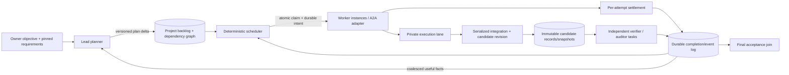

# Target design: continuous project delivery

Status: proposed concurrent-engine contracts. Initial settings/UI implementation
is underway; nothing in this document claims
that the new scheduler, snapshots, pool, or UI already exists.

See [role-policy.md](role-policy.md) for capabilities, practical tool rights and
the durable steering inbox required to keep the lead available during execution.

## Decisions and scope

D01. Keep the existing project server and SQLite ownership boundary. Introduce a
project-local delivery controller with a durable backlog and deterministic task
scheduler. Reuse A2A specialist execution and writer admission; do not replace the
Codex transport as part of the scheduler rewrite.

D02. Separate three loops: model planning, deterministic scheduling, and execution
settlement. They communicate through durable state/events. A slow worker does
not hold a planning turn or prevent processing another worker's completion.

D03. A role is a function/configuration; a worker instance is a particular active
attempt and provider thread. The lead chooses the team, decomposition and pipeline.
The runtime validates executable dependencies, capacity, authority, target identity
and effects. Templates are optional starting points, not a closed pipeline catalog.

D04. Prioritize a single project's delivery. Preserve existing independent project
servers and common-directory workspace locks. No global scheduler/account broker,
per-role account selection, or additional provider adapter is required here.

D05. Keep the legacy engine for existing runs. New objectives opt into the new
engine through an owner-side project setting when qualification permits. Never
run both scheduling engines as writers for the same workspace concurrently.

D06. Expand configuration and role cards together: counts, capability-correct
model/effort options, and Fast selection must round-trip into an actual attempt.
A visual control without request-level behavior does not satisfy the requirement.

## Runtime shape

The first adapter may keep role executors push-driven: the scheduler claims a
ready task on their behalf and sends it through existing A2A endpoints. A worker
pull endpoint can be added behind the same claim transaction. An LLM worker must
not scan and mutate queue rows directly or grant itself a wider assignment.

## Identities and records

IDs below are opaque stable IDs, scoped by project; timestamps are UTC. The
exact SQLite migration DDL and JSON schemas are CN-01 deliverables. These fields
and ownership are contractual minimums, not an instruction to store everything
as one JSON blob.

| Record | Required identity and content | Writer |
| --- | --- | --- |
| Objective | projectId, objectiveId, sessionId, legacyRunId?, engineVersion, goalRevision, requirementDigest, checksDigest, authorityRevision, controlRevision, disposition | Delivery controller |
| Task | taskId, objectiveId, revision, role, kind, objective, priority, explicit dependencies, writePaths, readScope, baseCandidateId?, checkpointId?, acceptance, checks, skills/tools/profile pins, evidenceRefs, retryPolicy, state, blockedReason?, idempotencyKey | Validated planner delta/controller |
| Dependency | predecessor task/checkpoint ID, successor task ID, edge kind, expected output/candidate contract | Validated planner delta |
| Attempt | attemptId, taskId, taskRevision, attemptNo, executionGeneration, providerContextId, externalTaskId?, threadId?, laneId?, contractDigest, selectedSettingsDigest, captured controls, state, outcome/effect/evidence refs | Scheduler/execution adapter |
| Claim | claimId, taskId, attemptId, ownerGeneration, fencingToken, role, capacityClass, leaseUntil, heartbeatAt, state | Scheduler transaction |
| Event | projectId, sequence, eventId, eventType, task/attempt/candidate IDs, object revision, bounded payload/evidenceRef, dedupeKey | Same transaction as state change |
| Candidate | candidateId, parentCandidateId?, integrationGeneration, snapshotRef, contentManifestDigest, sourceAttemptId?, attestedDeltaRef, environmentDigest?, status | Candidate store/integrator |
| Checkpoint | checkpointId, immutable reviewContextDigest, required policy/evidence, candidateId, dependencyClosure, state, recovery generation | Review policy |
| Receipt | receiptId, checkpointId, candidateId, contextDigest, inputManifestDigest, check/tool/profile pins, role, attemptId, outcome, evidenceRefs | Trusted result settlement |
| Planner state | projectId, sessionId, planningRevision, ownerGeneration, active turn/context, observed event cursor, pending trigger reasons, next wakeup | Delivery controller |

Task ID survives reprioritization and scope repair; a semantic contract change
increments revision. A running attempt retains its old immutable revision. Retries
receive distinct monotonic attempt IDs and deterministic A2A context IDs. A plan
cannot rewrite history, a submitted attempt contract, or a receipt.

Queue storage is independent of the number of concurrent agents. Page large
backlogs and bound individual plan/event payload sizes. A plan response may still
be limited to four task proposals if useful; repeated deltas fill the persistent
queue without waiting for those tasks to finish.

## Task and objective state

Task states: `draft`, `queued`, `ready`, `claimed`, `running`, `settling`,
`succeeded`, `blocked`, `failed`, `canceled`, `superseded`.

- `queued` has an accepted task contract but unmet readiness conditions. `ready`
  is a persisted projection; claim recomputes prerequisites under the transaction.
- `claimed` reserves task and capacity before any external effect. `running`
  requires known external task/turn identity. `settling` retains capacity/fences
  until outcome and process effects are known.
- `succeeded` means the task's declared output contract was met. For an engineer
  it may mean integrated output; it does not imply its checkpoint is accepted.
  Review tasks succeed only with a qualifying passing receipt for their candidate.
- `blocked` includes a typed cause and next action/wakeup. Retryable resource waits
  preserve the task; they do not become fabricated failures or owner questions.
- Failed attempts remain evidence. A task may return to queued only through its
  retry/replan policy. Accepted or superseded revisions are never silently reopened.

Dependencies have explicit meanings: `requires_output` waits for a task's verified
output contract; `requires_acceptance` waits for a checkpoint/candidate acceptance;
`integration_after` orders publication when needed. Cycles, unknown references,
self-dependencies and contradictory versions are rejected. A task writing a
critical component cannot disguise its dependent implementation as unrelated work.

Objective states: `planning`, `executing`, `draining`, `paused_owner`,
`waiting_budget`, `waiting_owner`, `recovering`, `blocked_technical`, `validating`,
`accepted`, `partial`, `canceled`. A planning or execution phase can overlap;
these labels are projections, with separate active planner/attempt fields.

A finite exhausted recovery becomes `blocked_technical` with preserved work and
evidence unless the owner requests finalization or the terminal-partial predicate
below holds. It does not masquerade as goal completion. Resume/replan is possible
without inventing a new objective or discarding accepted evidence.

## Readiness, claims and capacity

Proposed interfaces, implemented over the existing project SQLite connection:

- `applyPlan(expectedRevision, delta, authorityRevision)` validates a bounded plan
  delta, references and cycles, then commits task/dependency changes and events.
- `claimReady(projectId, schedulerGeneration, now)` atomically selects eligible
  tasks and creates claims/attempt intents within capacity and control limits.
- `recordSubmitted(attemptId, fencingToken, externalTaskId)` links known identity.
- `settleAttempt(attemptId, fencingToken, resultRef)` validates terminal execution,
  attests effects, changes task/checkpoint state and emits events exactly once.
- `reconcileAttempt(attemptId)` resolves uncertain submission/process/integration
  effects through existing journal lookup and quiescence before any replay.
- `projectBacklog(cursor, limit, filters)` and `projectCapacity()` expose additive,
  paginated views. They do not expose credentials or provider raw conversations.

Use a short SQLite immediate transaction for selection, dependency recheck, claim,
capacity reservation, durable dispatch intent and event/outbox entry. There is no
network await inside a transaction. `applyPlan` uses compare-and-swap revisions;
stale planner output cannot overwrite owner edits or a completed task.

The external A2A send follows committed intent. Remote acknowledgement and local
commit cannot be atomic. Reconcile by deterministic attempt context before resend;
absence or lookup failure for an uncertain writer is not proof of no effects.

Lease expiry is a recovery trigger, not permission to run a duplicate. Fencing
prevents stale local writes/receipt acceptance; it cannot stop a model or child
already running. Keep execution capacity reserved until remote task and process
quiescence are known. An unresolved writable effect fences its actual workspace/
dependency scope; unknown scope remains conservatively workspace-wide.

Capacity defaults proposed for the first release:

| Setting | Default | Meaning |
| --- | --- | --- |
| project maxActiveTurns | 12 | All live/reserved model turns, including planner |
| plannerReservedSlots | 1 | Worker claims cannot consume this slot |
| coordinator maxConcurrentAgents | 1 | Serialized planning turns per project/session |
| engineer | 4 | Up to four simultaneous engineer attempts |
| explorer / verifier / auditor | 2 each | Up to two simultaneous instances of each role |
| recovery-engineer / senior-engineer / architect | 1 each | On demand, using the same project pool |
| scout | 2 | On demand, using the same project pool |

All role counts are positive finite configurable integers, not fixed cardinalities
in a pipeline. The lead requests any subset within them. There is no unlimited
execution mode in the first release. Count active claims through settling/unknown
states, not just visible model calls. Shared workspace fallback serializes writable
execution but does not serialize independent read-only reviewers.

Budget/owner policy can reduce effective capacity to zero for new turns while
letting in-flight work settle. Effective capacity and its cause must be visible.
Decrease settings only for future claims; never kill a running attempt because a
limit was lowered. Preserve current stop-required role-setting semantics initially;
hot adjustment is an optional later extension, not hidden startup behavior.

## Continuous planning and autonomous team choice

One planner turn may run while independent worker attempts execute. Serialize
planner turns by a durable project/session fence and the existing provider thread
identity; never call the same provider thread concurrently.

Wake the planner for new/changed goals, missing useful ready work, a material
completion, a decision/recovery event, changed authority, or a meaningful deadline.
Coalesce duplicate events and use bounded debounce. Do not poll the model every
second or require a planning turn for every deterministic task completion.

Planner input is a consistent versioned projection: requirements, accepted evidence,
ready/blocked/active tasks, capacity, relevant source map, unresolved decisions and
unconsumed events. Return only task/dependency/policy proposals within that view.
Scheduling and promotion remain controller transactions. Revalidate a stale plan
against changed objects, preserving disjoint valid proposals rather than restarting
research or overwriting the queue.

Prepare roughly one additional pool's worth of genuinely independent ready work
when the goal supports it. This is a heuristic, not an obligation to invent work.
If readiness depends on unfinished implementation, plan conditional successors or
investigation tasks instead of guessing their results.

The lead chooses implementation, investigation, repair and review arrangements.
For small reversible changes, lead inspection plus focused deterministic evidence
may be sufficient when owner requirements permit it. Risk-changing work retains
independent verification/audit, with concrete scope and evidence. Audit templates
must state their trigger. Owner-required checks and independent-review obligations
cannot be removed by the lead to make a run finish.

Every prohibition needs a named protected invariant and a typed diagnostic.
Separate policy choices (team size below capacity, order, package size, routine
review strategy) from non-negotiable effects/authority/acceptance rules.

## Integration and immutable candidates

A private lane protects concurrent editing. Add a separate durable candidate
record/snapshot boundary so reviewers do not inspect the moving shared tree.

1. Prepare a lane from an identified base candidate with immutable attempt contract.
   Allocate test/build outputs, temporary databases and ports per attempt; shared
   environment links must not create hidden writable resources.
2. Execute isolated writers concurrently when write scopes and declared dependencies
   permit. `allowedFiles` is a write permission bound; it is not a complete read
   set, build-dependency proof, or evidence of semantic independence.
3. Serialize integration with existing workspace admission and mutex. Validate the
   base, attested patch scope, fences, controls and dependency version immediately
   before applying. A stale base/read dependency requires revalidation or repair,
   never an unrecorded rebase onto unaccepted changes.
4. Persist integration intent before applying. Capture resulting manifest and
   candidate lineage only after effect settlement. Mark the candidate known only
   after content attestation and durable event creation. A crash between effect and
   candidate record requires reconciliation, not a second patch application.
5. Materialize read snapshots from an attested candidate. Keep content-addressed
   metadata independent of filesystem retention. A candidate cannot be mutated in
   place or garbage-collected while attempts/receipts/acceptance reference it.

There is no claim that SQLite and Git/file effects form one transaction. Recovery
compares before/after manifests and integration process identity to resolve the
journaled window. Ambiguous effects stay unknown and preserve the admission fence.
Owner edits detected during integration must not be silently attributed to the
worker or promoted as reviewed output; preserve and reconcile the actual content.

## Parallel review and scoped gates

Bind review to `(projectId, objectiveId, checkpointId, candidateId,
reviewContextDigest, inputManifestDigest, pins)` and trusted attempt provenance.
Preserve goal/requirement/check identity from current policy. Read-only auditors
may run concurrently on the same immutable candidate for different risk questions
or separate checkpoints. Same-role duplicates need distinct task/attempt/thread IDs.
Verifier then auditor remains ordered when auditor depends on that verifier's
passing evidence for the same checkpoint. Two independent auditors do not acquire
an artificial dependency just because they have the same role.

Verifier checks run in a private candidate copy with allowed scratch outputs.
If a verifier authors a test/check change, it becomes an implementation proposal
and creates a new candidate on integration; its own mutation cannot certify the
old candidate or bypass pinned-check integrity review. Do not auto-publish verifier
changes through the existing lane path without candidate/review invalidation.

Relax a critical write gate only after candidate snapshots, dependency edges,
read-scope provenance and safe integration are qualified. Gates then block dependent
work or publication, rather than all project work. If dependencies/read scope are
unknown, use the existing broad barrier and explain the reason in backlog state.

Start with conservative repository-wide review input manifests, including config,
check scripts and the declared execution environment. Narrow reuse requires an
explicit validated dependency closure. The runtime cannot infer completeness from
write paths. Any unknown or changed manifest dimension prevents promotion.
A historical receipt remains true for its immutable candidate; it is never relabeled
as approval of a newer candidate. Promote/reuse only when the controller attests
identical required input closure/context/pins. Whole-tree mode may need fresh final
verification after unrelated integration; record that cost instead of hiding it.

To avoid endless invalidation, a final stabilization barrier stops new relevant
integration, drains its known writers, freezes the final candidate, then completes
the required reviews/checks together. It is a bounded acceptance join, not the
ordinary scheduling model. Unrelated implementation may continue in private lanes
but cannot publish into that final candidate while checks run.

## Completion and recovery

A worker blocker is a durable event/task reason. The lead investigates or creates
repair, scope expansion, dependency/environment or alternative-route tasks within
existing authority. Successful unrelated tasks and receipts survive a failed sibling.
Two failures of one hypothesis trigger replanning; they do not force an owner
question or an automatic stronger-model substitution. Preserve model/effort pins.

Continue existing bounded transient/review recovery policies, scoped to actual
task/checkpoint identities and candidate revisions. Persist retry budgets and
next wakeups. Budget waits wake through the existing authorized watcher route;
no resource pause grants new authority. Shared App Server termination may disrupt
siblings: fan out failure to all affected attempts, retain unknown effects, then
reconcile. Per-attempt provider subprocess isolation is a separate optimization.

Owner questions keep the existing typed owner-only categories after relevant
investigation. Ordinary sequencing, implementation and recoverable scope issues
are internal decisions. Owner deferral blocks only its named obligations.

Final acceptance requires a frozen known candidate, no unresolved relevant writer,
current required receipts, pinned checks and deterministic owner criteria. Store
accepted artifact fingerprint and disposition; later publication creates a new
candidate whose acceptance must be established separately.

A terminal partial requires a checked ledger and evidence that no task can make
remaining authorized progress: no ready/running/settling/planning claim, no known
retry/wakeup or executable recovery route, and each remainder has an investigated
outside-capability/authority blocker or explicit owner deferral. A finite internal
failure alone yields resumable `blocked_technical`; a model's free-text finish is
not an escape from unfinished executable work. Keep legacy partial history honest.

## Pause, cancellation and restart

Owner soft pause increments a durable control revision, prevents new claims and
planner starts, lets in-flight work settle, then parks without canceling it.
Pause request cancellation resumes scheduling only if that same control revision
is still current. Emergency stop aborts active attempts and preserves a resumable
objective after confirmed/reconciled effects. Explicit objective/task cancel stays
terminal; late completion cannot publish after cancellation.

A publication permit captures control revision and is rechecked under workspace
admission immediately before effect. The integration transaction defines whether
a concurrent pause/cancel precedes or follows publication intent. If effect already
started, settle its actual outcome; do not claim cancellation prevented it.

On restart, acquire existing DB/workspace locks, recover journal/candidate/claim
identities and reconcile active effects before releasing fences or replaying.
Process-local maps and lease expiry are never the source of truth. Persist cursors
for idempotent event consumption; a dropped in-memory wakeup is repaired by durable
pending events on startup. Coalesce events, not outcomes or task identity.

## Role cards: counts, effort and Fast

Add `maxConcurrentAgents` with profile defaults and per-project override to cards,
modal, API, config validation and effective role projection. Display configured
capacity, actual active instances and effective blocked capacity separately. Keep
older TOMLs/override documents valid; preserve existing model/effort/extraRules
when adding a count. Reject malformed new input without silently erasing valid
unrelated saved settings.

Model capability discovery must return supported reasoning efforts and service
tiers for the actual selected model/account. Correctly distinguish inherited
profile effort, saved explicit effort and effective request value. A model change
must revalidate effort, explain incompatible saved values, and never silently send
a different effort. Preserve custom valid configured models when catalog access
is unavailable; show unknown capability rather than an empty or false selection.

Use `fastMode` = `inherit | off | on` internally; UI shows Fast off / Fast on plus
an explicit inherited-default indication/reset. `off` requests standard/default
service tier for the turn; `on` resolves an advertised supported fast tier. The
installed schema does not establish a universal literal fast tier ID. The initial
implementation conservatively accepts exactly one advertised canonical `fast` ID,
and rejects descriptive-name guesses or ambiguous entries. Other tier identities
need explicit protocol/capability qualification before support is added.
Unknown/unavailable Fast cannot appear enabled or silently fall back. Persist and
pass the resolved tier through thread/turn creation and continuation; record it
with model/effort in attempt/usage provenance. Do not add per-role account routing.

## Observability and extension boundaries

Keep existing session/task/usage routes and polling clients compatible. Add
project-qualified paginated backlog, dependencies, worker instances, capacity,
blocked reasons, planner readiness and candidate/receipt projections. UI should
explain idle slots: no independent ready work, dependency, review, write conflict,
budget, owner pause, model capacity, or recovery. Do not treat all idle time as slow
inference or label capability inventory as successful execution evidence.

Measure backlog wait separately from writer admission wait, planner time, model
execution, settlement and final validation. Use durable events and existing usage
records; preserve null for unavailable timings. Cross-project fairness and role
account routing remain outside this delivery. No new global run mutex is allowed.
